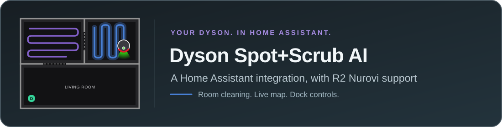
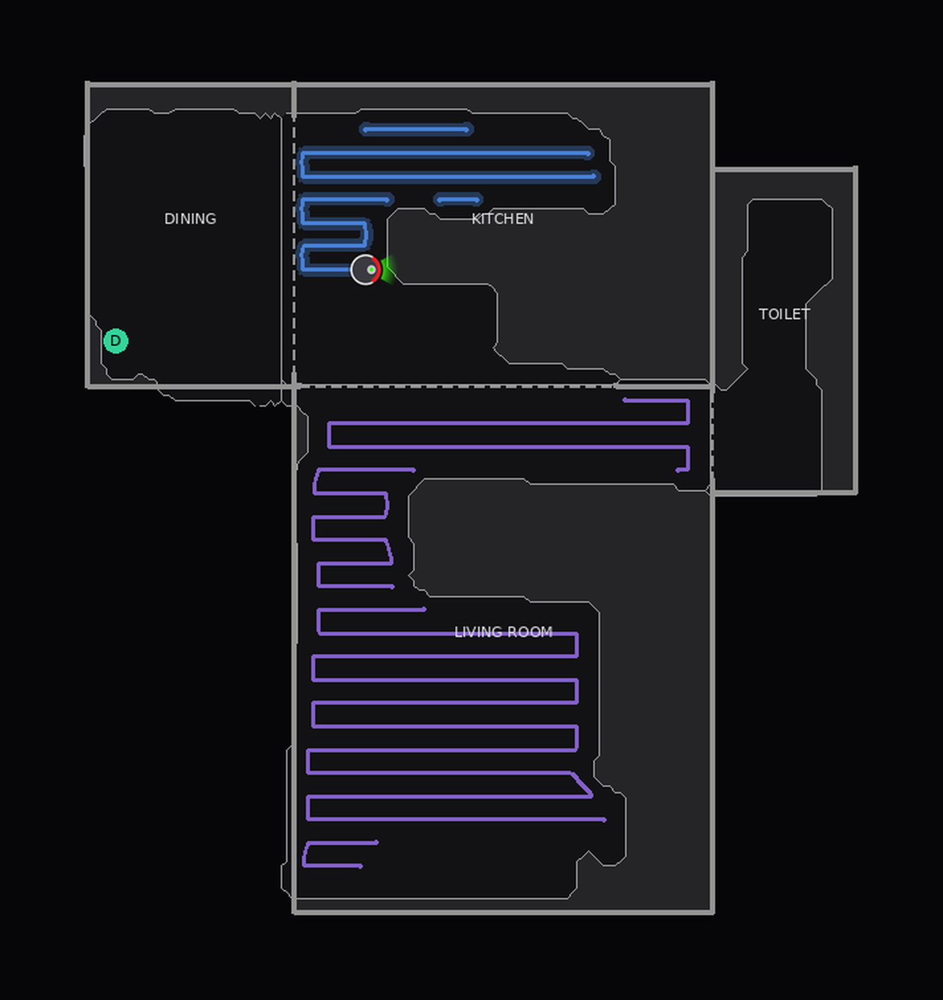
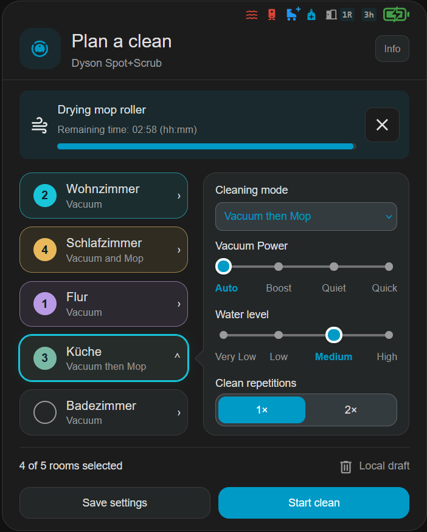
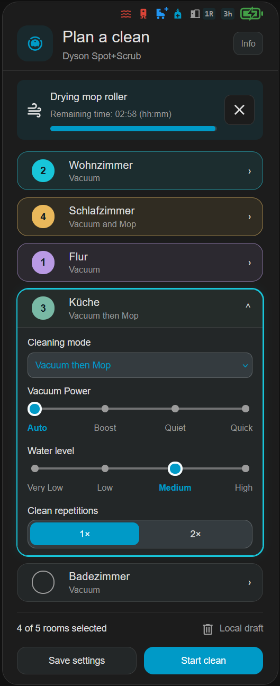
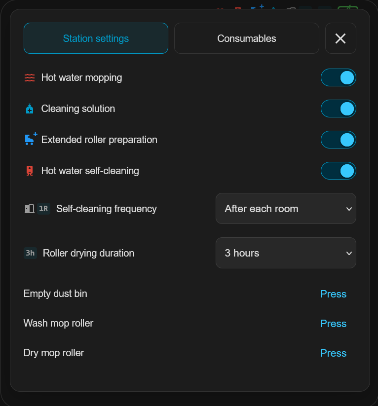
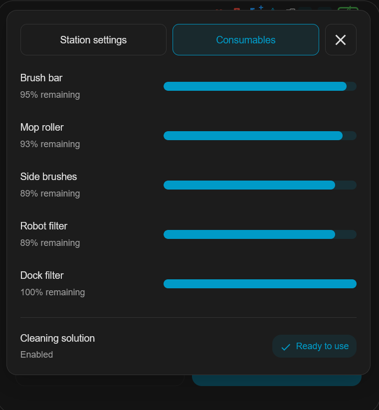

<p align="center">
  
</p>

<p align="center">
  <a href="https://my.home-assistant.io/redirect/marketplace_repository/?owner=UNsync3D&amp;repository=ha-dyson-spot-scrub&amp;category=integration">
    
  </a>
</p>

<p align="center">
  <a href="https://hacs.xyz"></a>
  <a href="https://github.com/UNsync3D/ha-dyson-spot-scrub/releases/latest"></a>
  <a href="https://github.com/UNsync3D/ha-dyson-spot-scrub/actions/workflows/validate.yml"></a>
  <a href="LICENSE"></a>
</p>

A custom Home Assistant integration for the **Dyson Spot+Scrub AI** robot vacuum, with support for the **Dyson R2 Nurovi Wash+Dry**. It connects through Dyson's cloud, the same way the MyDyson app does. The robot pushes status updates to Home Assistant over MQTT as they happen, so there's no constant polling. The robot doesn't accept local connections, so an internet connection is required.

### Supported robots

| Robot | Status |
|---|---|
| **Dyson Spot+Scrub AI** | Supported and tested on hardware |
| **Dyson R2 Nurovi Wash+Dry** | Supported, built from real R2 logs; owner testing welcome ([#32](https://github.com/UNsync3D/ha-dyson-spot-scrub/issues/32)) |
| **Dyson R1 Nurovi Dry**, **Dyson R3 Nurovi Spot+Scrub UV** | Not yet supported, but can be added as **experimental**: owners wanted to help test ([#30](https://github.com/UNsync3D/ha-dyson-spot-scrub/issues/30)) |

---

## Screenshots

<table>
  <tr>
    <td align="center" width="42%"><br>The live floor map, in the MyDyson app's style</td>
    <td align="center" width="58%"><br>Planning a clean with FutuRazor's card</td>
  </tr>
</table>

<table>
  <tr>
    <td align="center"><br>On a phone</td>
    <td align="center"><br>Station settings</td>
    <td align="center"><br>Consumables</td>
  </tr>
</table>

<sub>Card screenshots by <a href="https://github.com/FutuRazor">@FutuRazor</a>, from the <a href="https://github.com/FutuRazor/dyson-cleaning-planner-card">Dyson Cleaning Planner Card</a>. The floor map shows an example clean.</sub>

---

## Dashboard card: Dyson Cleaning Planner Card

This integration and **[FutuRazor's Dyson Cleaning Planner Card](https://github.com/FutuRazor/dyson-cleaning-planner-card)** are designed to work together. The integration connects Home Assistant to your robot and provides its entities and actions; the card turns them into one dashboard view built for the Spot+Scrub AI:

- **Plan a clean:** pick rooms, choose each room's settings and start, all in one place.
- **Follow the session:** see the cleaning status, the selected rooms and the live map.
- **No YAML needed:** select your Dyson vacuum in the card editor, and its rooms and supported controls are detected automatically.

The card needs **v1.5.0 or newer** of this integration. On Home Assistant 2026.11 or newer, install it from **Settings → Marketplace → Add from link** with `https://github.com/FutuRazor/dyson-cleaning-planner-card`; on older versions, add it in HACS as a custom repository (type **Dashboard**). The [card's README](https://github.com/FutuRazor/dyson-cleaning-planner-card#installation) has the details. You can also [try the interactive preview](https://futurazor.github.io/dyson-cleaning-planner-card/preview/index.html), which uses simulated data.

The card is developed and maintained by **[@FutuRazor](https://github.com/FutuRazor)**, who has also contributed much of this integration: the station controls, consumable sensors, mop drying controls, start readiness checks, map display options and card actions, along with extensive hardware testing, MQTT captures and code reviews. Thank you, FutuRazor! Please report card issues in the [card's repository](https://github.com/FutuRazor/dyson-cleaning-planner-card/issues).

---

## Features

**Robot**

| Entity | Type | Notes |
|---|---|---|
| Robot vacuum | `vacuum` | Start (whole home), pause, resume, stop, return to dock, suction power |
| Vacuum Mode | `select` | Room settings (default), or one mode for every room: Vacuum, Vacuum and Mop, Mop, or Vacuum then Mop. See [Cleaning modes](#cleaning-modes) |
| Vacuum Start | `button` | Cleans the rooms selected with the room switches, one at a time, returning to the dock between rooms. With none selected, cleans the whole home |
| Floor Map | `camera` | Live map of rooms, the cleaned path and the robot |
| Battery | `sensor` | Battery percentage |
| Docked, Charging, Fault | `binary_sensor` | Robot on the dock, battery charging, error reported |

**Rooms** (one set per room on the current map)

| Entity | Type | Notes |
|---|---|---|
| Room *name* | `switch` | Chooses whether the next **Start** cleans this room. Nothing is sent to the robot until you start |
| Room *name* Cleaning Mode, Cleaning Strategy, Water Level, Clean Repetitions | `select` | The room's saved settings, as in the MyDyson app |

**Dock and station**

| Entity | Type | Notes |
|---|---|---|
| Empty Bin, Wash Mop, Dry Mop | `button` | Dock actions. Available only while the robot is on the dock between cleans and the dock is idle |
| Hot water mopping, Hot water self-cleaning, Extended roller preparation, Cleaning solution | `switch` | Station settings (no cleaning solution on the R2) |
| Self-cleaning frequency, Roller drying duration | `select` | Station settings (drying: 3–5 hours on the Spot+Scrub AI, 2–4 hours on the R2) |
| Mop drying time remaining | `sensor` | Countdown while the mop is drying |
| Consumable usage, Cleaning solution | `sensor` | See [Consumables](#consumables) |

### When a clean can start

A new clean only starts when the robot is ready: not while it's cleaning or paused, on its way back, mapping, or while the dock is washing the mop or emptying the bin. Mop drying is the exception: starting a clean stops the drying first, as the MyDyson app does. Start on a paused clean resumes it.

### Consumables

The usage sensors show how much of each part's life is **used** (the MyDyson app shows what's **left**, so 2% here is 98% in the app):

- **Spot+Scrub AI:** brush bar, mop roller, side brushes, robot filter and dock filter, plus **Cleaning solution** (OK or Refill required).
- **R2 Nurovi Wash+Dry:** brush bar, **mop pad**, side brushes, robot filter and dock filter. The R2 has no cleaning solution.

### Mop drying

While the dock dries the mop, **Mop drying time remaining** counts down, using times reported by the robot about once a minute. The `dyson_spot_scrub.cancel_drying` action, or the card's Cancel drying button, stops it.

### Floor Map

The Floor Map camera entity draws a live PNG in the style of the MyDyson app:

- **Rooms:** walls, doors and room dividers from your Dyson map, with the floor the robot can reach shaded dark and the rest of each room grey.
- **Cleaned path:** smooth lines, purple for vacuuming and blue with a soft glow for mopping. Travel between areas isn't drawn.
- **Robot:** seen from above, with a red front bumper and a green beam showing which way it's heading.
- **Dock and room names:** names are centred in each room by default.

The map refreshes about every 5 seconds while the robot is cleaning, and every 60 seconds otherwise. After a clean, the last map is kept for 5 minutes by default.

**Map options** (the integration's **Configure** dialog):

- **Retention:** how long the finished map stays (0–60 minutes), or keep the last map until the next clean.
- **Transparent background:** for laying the map over your own floor plan.
- **Appearance:** path colours for vacuum, mop and vacuum-and-mop, path and glow width, and per-room colours.
- **Visible elements:** furniture, room names (and **Center room names**, or Dyson's positions), room areas, legend, cleaning status, walls, floor outlines, grid, dock, keep-out zones, and **Show floor shading**.

### Cleaning modes

The **Vacuum Mode** select decides the mode for cleans started from Home Assistant (the vacuum's Start, the Vacuum Start button and the `clean_room` / `clean_rooms` actions):

- **Room settings** (the default): each room is cleaned with the mode saved for it in the MyDyson app.
- **Any other mode**: every room being cleaned uses that mode, and it's saved as the room's mode, as when you change it in the app.

The choice resets to Room settings when Home Assistant restarts. The [Dyson Cleaning Planner Card](#dashboard-card-dyson-cleaning-planner-card) and `start_rooms_with_settings` always use the room settings they send.

| Mode | What the robot does |
|---|---|
| Room settings | Each room's own saved mode |
| Vacuum | Suction only |
| Vacuum and Mop | Both simultaneously |
| Mop | Wet mopping only |
| Vacuum then Mop | Full vacuum pass, then full mop pass |

### Actions

| Action | What it does |
|---|---|
| `dyson_spot_scrub.clean_room` | Cleans one room, by name, using the Vacuum Mode |
| `dyson_spot_scrub.clean_rooms` | Cleans several rooms one at a time, using the Vacuum Mode |
| `dyson_spot_scrub.save_room_settings` | Saves several rooms' settings at once, without starting |
| `dyson_spot_scrub.start_rooms_with_settings` | Starts the given rooms with the given settings (each room keeps its own mode) |
| `dyson_spot_scrub.clean_zone` | Cleans one rectangle on the map with its own settings (Spot+Scrub AI) |
| `dyson_spot_scrub.clean_whole_home` | Starts a whole-home clean, like the robot's own button (Spot+Scrub AI) |
| `dyson_spot_scrub.cancel_drying` | Stops mop drying |

The room select entities save each change straight away. `save_room_settings` saves a batch in one go, using stable room IDs and the same option labels as the select entities:

```yaml
action: dyson_spot_scrub.save_room_settings
data:
  entity_id: vacuum.dyson_spot_scrub
  room_settings:
    "12":
      cleaning_mode: Vacuum then Mop
      cleaning_strategy: Auto
      water_level: Medium
      mop_repetitions: Two Passes
```

`mop_repetitions` sets the room's **Clean Repetitions** select (one or two passes). Despite its field name, the second pass also applies to vacuum-only cleans.

`start_rooms_with_settings` saves the supplied settings, then starts the rooms in one clean. The rooms are sent in the order given, but Dyson's protocol calls this list `unorderedZones`, so the robot may choose its own order.

```yaml
action: dyson_spot_scrub.start_rooms_with_settings
data:
  entity_id: vacuum.dyson_spot_scrub
  room_ids: ["12", "10"]
  room_settings:
    "12":
      cleaning_mode: Vacuum then Mop
```

`clean_zone` cleans one rectangle, like the MyDyson app's **Target** mode: the [Dyson Cleaning Planner Card](https://github.com/FutuRazor/dyson-cleaning-planner-card) lets you draw it on the map. The rectangle is in robot coordinates (metres), on the map the robot is using now. Optional settings are `clean_type` (`vacuum`, `vacuumAndMop`, `mop`, `vacuumThenMop`), `cleaning_strategy` (`auto`, `boost`, `quiet`, `quick`), `water_level` (`veryLow`, `low`, `medium`, `high`) and `mop_passes` (1 or 2; 2 repeats the clean for every cleaning mode). Room settings aren't changed. See [zone cleaning](docs/ZONE_CLEANING.md) for the details and the map calibration the card uses.

```yaml
action: dyson_spot_scrub.clean_zone
data:
  entity_id: vacuum.dyson_spot_scrub
  map_id: "1234567890"
  rectangle: [-1.5, 0.5, 1.0, 2.5]
  clean_type: vacuumAndMop
  water_level: medium
```

`clean_whole_home` starts the same whole-home clean as the button on the robot. The MyDyson app has no equivalent: there you select every room. It doesn't change any room settings. It's also available as the **Clean Whole Home** button. It's confirmed on the Spot+Scrub AI only so far; on the Dyson R2 Nurovi Wash+Dry it isn't offered yet.

```yaml
action: dyson_spot_scrub.clean_whole_home
data:
  entity_id: vacuum.dyson_spot_scrub
```

### For dashboard card developers

The vacuum entity exposes `ready_to_start` (true/false) and `start_block_reason` (a reason code, or `null` when ready), so a card can disable Start and say why; Home Assistant enforces the same rule. While drying, it also exposes `drying_total_seconds`, `drying_remaining_seconds` and `drying_updated_at` (when the last timing report arrived), so a card can show progress as `(total - remaining) / total`. The dock state, not a zero countdown, decides whether drying is active. More detail: [start readiness](START_READINESS.md) and [consumable sensors](CONSUMABLES.md).

---

## Requirements

- Home Assistant **2025.1** or newer
- The robot already registered in the **Dyson app**
- Your **Dyson account email and password**, with access to the email inbox for a one-time code — or, alternatively, a Dyson **bearer token** (see [Getting a bearer token](#getting-a-bearer-token))
- Your Dyson account's **country code** (see [Country codes](#country-codes)); the token method also needs the robot's **serial number**

---

## Installation

The integration is listed in HACS, so there's no repository to add by hand.

### Option A — Marketplace (Home Assistant 2026.11 or newer, recommended)

1. Go to **Settings → Marketplace**, or select the **Open in Home Assistant Marketplace** button at the top of this page.
2. Search for **Dyson Spot+Scrub AI**, open it and select **Install**.
3. Restart Home Assistant, then continue with [Setup](#setup).

### Option B — HACS (Home Assistant 2026.10 or older)

1. Open **HACS** and search for **Dyson Spot+Scrub AI**.
2. Open it and select **Download**.
3. Restart Home Assistant, then continue with [Setup](#setup).

> **Already installed it from a custom repository or link?** You don't need to do anything: updates keep arriving as before.

### Option C — Manual

Copy the `custom_components/dyson_spot_scrub/` folder into your HA config directory:

```
<config>/custom_components/dyson_spot_scrub/
```

Restart Home Assistant.

---

## Setup

1. Go to **Settings → Devices & Services → Add Integration**
2. Search for **Dyson Spot+Scrub AI**
3. Choose how to sign in:
   - **Log in with Dyson account (email + OTP)** — see [Email login](#email-login) below
   - **Enter a bearer token directly** — see [Getting a bearer token](#getting-a-bearer-token)
4. The integration finds the robot(s) on your account and creates their entities

### Country codes

Enter the two-letter code of the country your Dyson account was created in, which is usually where you bought the robot. It must match the account, or sign-in fails. Setup suggests your Home Assistant country.

| Region | Codes |
|---|---|
| Oceania | `AU` Australia, `NZ` New Zealand |
| UK and Ireland | `GB` United Kingdom (not `UK`), `IE` Ireland |
| North America | `US` United States, `CA` Canada, `MX` Mexico |
| Western Europe | `DE` Germany, `AT` Austria, `CH` Switzerland, `FR` France, `BE` Belgium, `NL` Netherlands, `LU` Luxembourg, `IT` Italy, `ES` Spain, `PT` Portugal |
| Northern and Eastern Europe | `SE` Sweden, `NO` Norway, `DK` Denmark, `FI` Finland, `PL` Poland, `CZ` Czechia |
| Asia | `JP` Japan, `KR` South Korea, `SG` Singapore, `MY` Malaysia, `HK` Hong Kong, `TW` Taiwan, `IN` India |
| Middle East | `AE` United Arab Emirates, `SA` Saudi Arabia, `IL` Israel |

Any other two-letter country code works too. Accounts in mainland China (`CN`) use a separate Dyson service and haven't been tested.

### Email login

The integration signs in the same way the MyDyson iOS app does:

1. Enter your Dyson account **email**, **password** and **country code**.
2. The integration checks that your account is active and uses email codes, then Dyson emails you a **6-digit code**. If the account isn't reported as active, it stops here and no code is requested.
3. Enter the code. Dyson checks your **password and the code together** at this step, then the integration fetches your robots and sets them up.

Your password is only used for this sign-in and is not stored; Home Assistant keeps only the resulting token, as with the token method.

**If the code is rejected:**

- **Check your password first.** Dyson only checks the password at the last step, after the code has been emailed, and it gives the same rejection for a wrong password, a wrong code and a locked account.
- The code screen then shows a **password** field. Correct the password there and resubmit the **same code** — no new email is needed. Leave the field blank to keep the password you entered before.
- **After two rejections in a row, stop.** The integration pauses sign-in attempts for that email for 15 minutes, because repeated attempts can get a Dyson account temporarily locked. If codes keep being rejected with the right password, wait several hours or contact Dyson support rather than retrying.

Logging in here doesn't sign you out of the MyDyson app: each login gets its own token. Questions and reports: [issue #25](https://github.com/UNsync3D/ha-dyson-spot-scrub/issues/25).

---

## Getting a bearer token

Only needed if you choose the token method instead of [Email login](#email-login). The easiest way to get your Dyson bearer token is to intercept the Dyson app's network traffic using **Proxyman** on a Mac with your iPhone on the same Wi-Fi network. This takes about 5 minutes.

<details>
<summary>Show the Proxyman steps</summary>

### Step 1 — Install Proxyman on your Mac

Download and install [Proxyman](https://proxyman.io) (free tier is sufficient). Launch it.

### Step 2 — Install the Proxyman certificate on your iPhone

1. In Proxyman, go to **Certificate → Install Certificate on iOS → Physical Device**
2. Follow the on-screen instructions — this involves visiting a URL on your iPhone and installing a profile
3. On your iPhone, go to **Settings → General → VPN & Device Management** and trust the Proxyman certificate
4. Then go to **Settings → General → About → Certificate Trust Settings** and toggle the Proxyman root CA to fully trusted

### Step 3 — Configure your iPhone's proxy

1. On your iPhone, go to **Settings → Wi-Fi** and tap the ℹ️ next to your current network
2. Scroll down to **HTTP Proxy** → **Configure Proxy → Manual**
3. Set **Server** to your Mac's IP address (shown in Proxyman's title bar) and **Port** to `9090`

### Step 4 — Capture the token

1. Open the **Dyson app** on your iPhone and log in (or pull down to refresh if already logged in)
2. In Proxyman on your Mac, look for requests to `appapi.cp.dyson.com`
3. Click on any of those requests and open the **Request** tab
4. Find the **Authorization** header — its value will look like:

   ```
   Bearer XXXXXXXXXXXXXXXXXXXXXXXXXXXXXXXXXXXXXXXXXXXXXXXXXXXXXXXXXXXXXXXX-1
   ```

5. Copy everything **after** the word `Bearer ` (including the long hex string and the `-1` suffix)

### Step 5 — Paste into Home Assistant

Use this token in the **Enter a bearer token directly** step of the integration setup. Tokens are long-lived — you should only need to do this once.

> **After setup:** Remove the proxy from your iPhone's Wi-Fi settings so normal traffic isn't routed through your Mac.

</details>

---

## How it works

1. **Authenticate**: email login or a pasted token gives a bearer token, which is stored in HA's config entry — your Dyson password is never stored.
2. **IoT credentials**: when it starts or reconnects, the integration fetches short-lived MQTT credentials for your robot from Dyson's cloud.
3. **MQTT**: the integration then connects to Dyson's cloud MQTT broker over a WebSocket, as the MyDyson app does. Commands go out and status updates arrive over this connection as they happen. The floor map comes from Dyson's cloud separately: about every 5 seconds while cleaning, and every 60 seconds otherwise.
4. **Auto-recovery**: if the MQTT connection drops, the integration automatically fetches fresh credentials and reconnects with exponential backoff (15 s → 30 s → 60 s → 120 s).

---

## Troubleshooting

### Integration not found after install
Restart Home Assistant after installing. For a manual install, make sure the folder is named exactly `dyson_spot_scrub` inside `custom_components/`.

### Can't find it when searching in HACS or the Marketplace
New listings can take a few hours to appear. In HACS, select **⋮ → Update information** and search again.

### Bearer token is rejected
- Make sure you copied the full token value — it should be 65+ characters ending in `-1` or similar
- If a token stops working, sign in again with [Email login](#email-login), or capture a fresh token with Proxyman

### Floor map is blank or shows an error
- The map needs a saved floor map: let the robot map your home in the MyDyson app first
- Check the HA logs for `dyson_spot_scrub` errors — the map entity logs rendering failures at `WARNING` level

### Robot shows as Unavailable
Either the connection to Dyson's cloud dropped, or Dyson reports the robot itself as offline (for example, it's off Wi-Fi or switched off). The integration recovers from both on its own: it reconnects automatically, and while the robot is offline it asks for its status once a minute. If the robot shows as online in the MyDyson app but stays unavailable here, reload the integration from **Settings → Devices & Services**.

### Email login code is rejected
See [Email login](#email-login): check the password first, correct it on the code screen and resubmit the same code, and stop after two rejections.

### "Cannot connect" during setup
Dyson's cloud API may be temporarily unavailable. Wait a few minutes and try again.

### Reporting a problem
Open an [issue](https://github.com/UNsync3D/ha-dyson-spot-scrub/issues) with a debug log: go to **Settings → Devices & services → Dyson Spot+Scrub AI → ⋮ → Enable debug logging**, reproduce the problem, then **Disable debug logging** to download the log. Remove your robot's serial number before posting. Passwords, tokens and the robot's local password are already hidden.

---

## Development

```bash
# Clone
git clone https://github.com/UNsync3D/ha-dyson-spot-scrub
cd ha-dyson-spot-scrub

# Symlink into your local HA dev instance
ln -s $PWD/custom_components/dyson_spot_scrub \
      ~/.homeassistant/custom_components/dyson_spot_scrub
```

Run the tests with `python -m unittest discover -s tests`. Pull requests are welcome; please open an issue before starting significant work so we can coordinate.

---

---

## Licence

MIT
